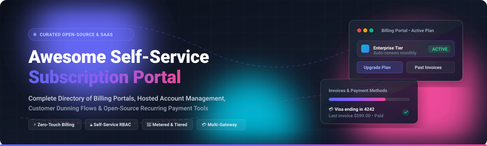

# 💳 Awesome Self-Service Subscription Portal 🚀

  

# 🌟 Modern Self-Service Subscription Portals & Billing Engines 🌟

  
  
  
  
  
  

  <strong>A comprehensive, SEO-optimized directory of developer-first Self-Service Subscription Portals, Hosted Billing Interfaces, Customer Account Dashboards, and Open-Source Recurring Payment Tools.</strong>

  <em>Enable zero-touch customer billing, self-service subscription upgrades/downgrades, automated invoice downloads, and dunning deflection without engineering overhead.</em>

  🌟 <strong>Star this repository if you find it valuable!</strong> 🌟

---

## 🔍 Overview & SEO Highlights 🎯

Empower customers to manage their payment methods, billing tiers, metered invoices, and cancellation retention flows without human support intervention. Whether you need **cloud-hosted checkout and billing portals** (Stripe, Chargebee, Recurly) or **self-hosted open-source metering infrastructure** (Lago, Kill Bill, FOSSBilling, Meteroid), this curated list guides engineering leads, founders, and billing architects to choose the best solution.

### 🔑 Key Search Keywords:
`self service subscription portal` • `customer billing portal` • `open source billing engine` • `stripe customer portal alternatives` • `hosted account management` • `recurring billing software` • `usage-based metering` • `subscription retention dunning` • `saas payment portal`

---

## 📋 Table of Contents 📑

- [🌐 Sector Overview & Market Dynamics](#-sector-overview--market-dynamics)
- [🟦 SaaS / Hosted Platforms](#-saas--hosted-platforms)
- [🟩 Open-Source Software](#-open-source-software)
  - [1. Lago](#1-lago-)
  - [2. Kill Bill & Kaui](#2-kill-bill--kaui-)
  - [3. FOSSBilling](#3-fossbilling-)
  - [4. Meteroid](#4-meteroid-)
  - [5. Jetstream Cashier Billing Portal](#5-jetstream-cashier-billing-portal-)
  - [6. pnlcs (WHMCS Alternative)](#6-pnlcs-whmcs-alternative-)
  - [7. Chargebee Customer Portal PHP](#7-chargebee-customer-portal-php-)
  - [8. UniBee User Portal](#8-unibee-user-portal-)
  - [9. Entando Customer Portal](#9-entando-customer-portal-)
  - [10. stapel-billing](#10-stapel-billing-)
- [📊 Comparison at a Glance](#-comparison-at-a-glance)
- [📈 Star History](#-star-history)
- [🤝 Contributing](#-contributing)
- [📄 License](#-license)

---

## 🌐 Sector Overview & Market Dynamics 📊

The global subscription management and recurring billing software sector is valued at approximately **$7.5B to $8.5B in 2024–2025** and is projected to expand to **$18B–$20B by 2030** at a compound annual growth rate (CAGR) of ~16.5%. 

The market exhibits **moderate fragmentation with high concentration at the high-volume gateway layer** (where juggernauts like Stripe dominate developer-first payment infrastructure), yet remains **highly competitive and fragmented across specialized enterprise lifecycle billing, metered AI/usage-based pricing, and self-hosted open-source stacks** where vendor lock-in concerns and complex ERP/accounting integrations prevent a single winner-take-all monopoly.

---

## 🟦 SaaS / Hosted Platforms ☁️

Commercial, cloud-hosted Self-Service Subscription Portal platforms. These are not open-source but are included as reference points for feature comparison. Sorted in descending order by company size (valuation / revenue).

| Platform 🏷️ | Company Size (Valuation / Revenue) 💼 | Pricing 💰 | Free Tier / Free Trial Limits 🎁 | Embeddable / Hosted 🖥️ | Key Capabilities ⚡ |
| :--- | :--- | :--- | :--- | :--- | :--- |
| **[Stripe Customer Portal](https://stripe.com/billing)** | $91.5B valuation (tender offer, 2025); $5.1B+ revenue (2024) | Pay-as-you-go: 0.7% on recurring billing volume (custom plans available; optional custom domain at $10/month) | Free in Test Mode with full sandbox access; 0.7% pay-as-you-go fee on live billing volume with no monthly base subscription fee | Hosted only (supports custom domains) | Self-service billing/payment management, tax ID updates, invoice history download, cancellation deflection flows with automatic discounts/coupons |
| **[Chargebee Self-Serve Portal](https://www.chargebee.com/)** | $3.5B valuation (Series H); $150M+ ARR | Starter Plan: $0/mo (up to $250k lifetime billing limit, then 0.75% overage); Performance Plan: $599/mo billed annually (up to $100k/mo billing, +0.75% overage) | Free forever on Starter Plan up to $250,000 in cumulative lifetime billing volume; free full-featured sandbox/test account | Both (in-app modal via Chargebee.js or modular embedded widgets) | In-app modal or granular widgets, account and plan switching, invoice download, payment method updates, SSO authentication |
| **[Recurly Hosted Account Management](https://recurly.com/)** | ~$100M–$200M est. valuation (majority acquired by Accel-KKR; ~$20M+ ARR) | Starter Plan: $249/mo + 0.9% of billing volume; All-Access Plan: Custom quote (typically $1M+ annual volume minimum) | 90-day free trial on Starter Plan with up to $40,000/mo included billing volume; full sandbox developer testing | Hosted (white-labeled pages or API) | White-labeled branded pages, token-based authentication (Account Login vs. Guest View), past invoice retrieval, payment method changes, gift card redemption |
| **[Lago Customer Portal](https://www.getlago.com/)** | $100M valuation ($22M total venture funding raised) | Open-Source Self-Hosted: $0/mo (AGPL-3.0); Lago Cloud / Premium: Custom quote based on event ingestion volume | Free forever self-hosted under AGPL-3.0 with complete core billing/metering engine; cloud proof-of-concept trial available via direct sales/demo request | Embeddable (iframe via `/customers/:id/portal_url`) | Embeddable iframe portal, real-time usage metering visibility, subscription management, automated invoice downloads, native API-generated access |
| **[UniBee User Portal](https://unibee.dev/)** | Early-stage private / unfunded (~$2M–$5M est.) | Open-Source Self-Hosted: $0/mo (AGPL-3.0); Cloud Starter: $99/mo; Cloud Business: $399/mo | Free forever self-hosted under AGPL-3.0; Cloud Starter & Business tiers include a free trial upon signup with full core billing and analytics features | Dedicated open-source user portal (`unibee-user-portal` web app) | Gateway-agnostic customer portal, recurring subscription overview, invoice retrieval, multi-currency support, zero revenue-share percentage fees |

---

## 🟩 Open-Source Software 🔓

Self-hosted, community-driven Self-Service Subscription Portal tools, client portals, and recurring billing frameworks. Sorted in descending order by GitHub stargazers count (with social badges linking directly to stargazers).

### 1. Lago 🌊

- **Repository:** [`getlago/lago`](https://github.com/getlago/lago) 🐙
- **Stack:** Ruby / Go / TypeScript | **License:** AGPL-3.0 📜
- **Description:** Lago is an open-source metering and usage-based billing platform designed as an open architecture alternative to Stripe Billing and Chargebee. It includes an embeddable customer portal generated via API (`/customers/:external_customer_id/portal_url`) that can be loaded in an iframe, allowing end users to review active subscriptions, consumption metrics, wallets, credits, and invoices.
- **Best for:** 💡 Modern SaaS and API companies with consumption/hybrid pricing wanting an open-source metering engine with embeddable client visibility.

### 2. Kill Bill & Kaui ⚔️

- **Repository:** [`killbill/killbill`](https://github.com/killbill/killbill) & [`killbill/killbill-admin-ui`](https://github.com/killbill/killbill-admin-ui) 🐙
- **Stack:** Java / Ruby (Kaui UI) | **License:** Apache-2.0 📜
- **Description:** Kill Bill is the enterprise standard open-source subscription billing and payments engine, operating in large-scale production since 2010. Kaui is its administrative back-office UI for managing tenants, invoices, payment gateways, and recurring plans. While Kaui is operator-facing, Kill Bill exposes an extensive, battle-tested REST API enabling teams to build zero-compromise customer-facing self-service portals.
- **Best for:** 💡 Large enterprises and fintech teams requiring a customizable, multi-gateway billing engine with complex dunning logic.

### 3. FOSSBilling 🧾

- **Repository:** [`FOSSBilling/FOSSBilling`](https://github.com/FOSSBilling/FOSSBilling) 🐙
- **Stack:** PHP / Twig / MySQL | **License:** Apache-2.0 📜
- **Description:** FOSSBilling is a community-driven, open-source billing and client management software solution tailored for digital agencies, hosting providers, and subscription web services. It includes a complete out-of-the-box self-service client portal where customers can manage registered accounts, pay invoices, renew recurring plans, change payment methods, and open support tickets.
- **Best for:** 💡 Digital agencies, VPS/hosting businesses, and web service teams wanting a lightweight, turn-key customer billing portal.

### 4. Meteroid ⏱️

- **Repository:** [`meteroid-oss/meteroid`](https://github.com/meteroid-oss/meteroid) 🐙
- **Stack:** Rust / TypeScript / React | **License:** Apache-2.0 📜
- **Description:** Meteroid is a developer-friendly, open-source pricing and billing infrastructure built specifically for subscriptions, usage-based consumption, and hybrid monetization. It features a built-in customer portal interface where subscribers can track wallet credit balances, inspect real-time usage consumption, change subscription tiers, and update Stripe payment details.
- **Best for:** 💡 AI products, developer platforms, and high-frequency usage services seeking a modern Rust-powered billing stack with native customer portal capabilities.

### 5. Jetstream Cashier Billing Portal 🚀

- **Repository:** [`renoki-co/jetstream-cashier-billing-portal`](https://github.com/renoki-co/jetstream-cashier-billing-portal) 🐙
- **Stack:** PHP / Laravel Jetstream / Cashier | **License:** MIT 📜
- **Description:** A dedicated open-source Laravel Jetstream integration providing a full self-service customer billing portal on top of Laravel Cashier (Stripe). It serves as a lightweight open-source alternative to Laravel Spark, empowering users to self-manage subscriptions, toggle plans, inspect quota allocations (seats, projects, API requests), view invoices, and manage payment methods.
- **Best for:** 💡 Laravel developers building SaaS applications who want a self-service customer billing portal without recurring proprietary framework fees.

### 6. pnlcs (WHMCS Alternative) 🖥️

- **Repository:** [`Panelica/pnlcs`](https://github.com/Panelica/pnlcs) 🐙
- **Stack:** Laravel 13 / PHP / MySQL | **License:** MIT 📜
- **Description:** pnlcs is a modern, open-source WHMCS alternative for hosting billing and client portal automation. It delivers an intuitive customer-facing portal handling recurring invoicing, multi-language localization (30 locales), 16 switchable UI themes, domain renewals, SSL management, and integrated support ticket workflows.
- **Best for:** 💡 Hosting companies, cloud service providers, and infrastructure resellers needing a self-hosted, modular customer portal.

### 7. Chargebee Customer Portal PHP 🐘

- **Repository:** [`chargebee/customer-portal-php`](https://github.com/chargebee/customer-portal-php) 🐙
- **Stack:** PHP / Bootstrap UI / Chargebee API | **License:** MIT 📜
- **Description:** Chargebee's official open-source reference implementation of a customer-facing self-service portal. It provides complete, customizable source code demonstrating how to build an independent web portal allowing subscribers to log in, view current plans, pause/resume subscriptions, initiate upgrades/downgrades, and retrieve billing histories directly via Chargebee's REST API.
- **Best for:** 💡 Developers using Chargebee who want complete design and code control over their customer portal rather than embedding hosted modals.

### 8. UniBee User Portal 🐝

- **Repository:** [`UniBee-Billing/unibee-user-portal`](https://github.com/UniBee-Billing/unibee-user-portal) 🐙
- **Stack:** TypeScript / React / Tailwind | **License:** AGPL-3.0 📜
- **Description:** UniBee maintains this dedicated customer-facing portal web application for its gateway-agnostic recurring billing engine. Subscribers can log into the portal to review active subscriptions, preview upcoming charges, switch recurring plans, download past PDF invoices, and manage saved credit cards without administrative overhead.
- **Best for:** 💡 Teams deploying the UniBee billing backend seeking an off-the-shelf, modern TypeScript frontend for end-user self-service.

### 9. Entando Customer Portal 🏢

- **Repository:** [`entando/customer-portal`](https://github.com/entando/customer-portal) 🐙
- **Stack:** Java / Spring Boot / Keycloak / Kubernetes | **License:** LGPL-3.0 📜
- **Description:** Entando's Customer Portal is a Kubernetes-native enterprise reference architecture integrated with Keycloak for identity/RBAC and Jira Service Management for ticketing. It demonstrates micro-frontend modularity for enterprise client account self-service, subscription visibility, project management, and user permissions.
- **Best for:** 💡 Enterprise organizations on Entando or Kubernetes requiring an RBAC-governed customer portal architecture.

### 10. stapel-billing 🐍

- **Repository:** [`usestapel/stapel-billing`](https://github.com/usestapel/stapel-billing) 🐙
- **Stack:** Python / Django / Stripe | **License:** MIT 📜
- **Description:** stapel-billing is a modular Django app providing payments and billing with per-user credit wallets, one-off credit packages, and recurring subscription plans. It includes Stripe-backed checkout and an integrated self-service customer portal, idempotent webhooks, and service-to-service debit endpoints within the Stapel Django ecosystem.
- **Best for:** 💡 Django developers looking for a lightweight, pluggable app that bundles Stripe subscriptions and a native customer self-service portal.

---

## 📊 Comparison at a Glance ⚖️

| Software 📦 | License 📜 | Stack 💻 | Portal Type 🖥️ | Usage Metering ⚡ | Self-Hosted 🏠 | Best For 🎯 |
| :--- | :--- | :--- | :--- | :--- | :--- | :--- |
| **Stripe** | Proprietary | Cloud API | Hosted Portal | ✅ | ❌ | Zero-development turnkey portal |
| **Chargebee** | Proprietary | Cloud API | Modal / Widgets | ✅ | ❌ | Embeddable in-app self-service |
| **Recurly** | Proprietary | Cloud API | Hosted (Branded) | ✅ | ❌ | White-labeled enterprise pages |
| **Lago** | AGPL-3.0 | Ruby/Go/TS | Embeddable iframe | ✅ | ✅ | Consumption/hybrid SaaS metering |
| **Kill Bill** | Apache-2.0 | Java / Ruby | Admin UI / Custom Portal | ✅ | ✅ | High-volume multi-gateway engine |
| **FOSSBilling** | Apache-2.0 | PHP / Twig | Complete Client Portal | ❌ | ✅ | Turn-key client management & billing |
| **Meteroid** | Apache-2.0 | Rust / React | Native Customer Portal | ✅ | ✅ | Modern usage-based pricing & wallets |
| **Jetstream Cashier** | MIT | PHP / Laravel | Jetstream App Portal | ✅ (Quota) | ✅ | Laravel Cashier billing portal |
| **pnlcs** | MIT | Laravel / PHP | Self-Hosted Client Portal | ❌ | ✅ | Hosting & domain client portal |
| **Chargebee PHP** | MIT | PHP / Bootstrap | Reference Web Portal | ✅ | ✅ | Custom Chargebee portal frontend |
| **UniBee** | AGPL-3.0 | TypeScript | Dedicated User Portal | ✅ | ✅ | Gateway-agnostic recurring billing |
| **stapel-billing** | MIT | Python/Django | Pluggable App Portal | ✅ (Wallets) | ✅ | Django Python web applications |

---

## 📈 Star History

---

## 🤝 Contributing 🤝

Contributions and suggestions are always welcome! 💖 If you know of an active open-source Self-Service Subscription Portal tool, client portal framework, or billing component that belongs here, please submit a Pull Request following these guidelines:

1. **Check Relevance:** Must provide a customer-facing billing/subscription portal or API architecture specifically enabling end-user account self-service.
2. **Maintenance Check:** Actively maintained with releases or commits within the last 12 months.
3. **Open Source Verification:** Verify the repository has an OSI-compliant license (MIT, Apache-2.0, AGPL-3.0, etc.).
4. **Format:** Submit your PR with the tool name, GitHub link, tech stack, license, star count badge, and a concise 1–2 sentence description.

---

## 📄 License 📜

This list is released under the [Creative Commons Zero v1.0 Universal](https://creativecommons.org/publicdomain/zero/1.0/) (CC0 1.0) Public Domain Dedication. Listed software platforms and repositories retain their respective licenses and trademarks.

---

  
⭐ <strong>Star this repository if it helped streamline your subscription billing architecture!</strong> ⭐

  
Maintained with ❤️ by <a href="https://github.com/ishandutta2007">Ishan Dutta</a> and the global open-source community.

